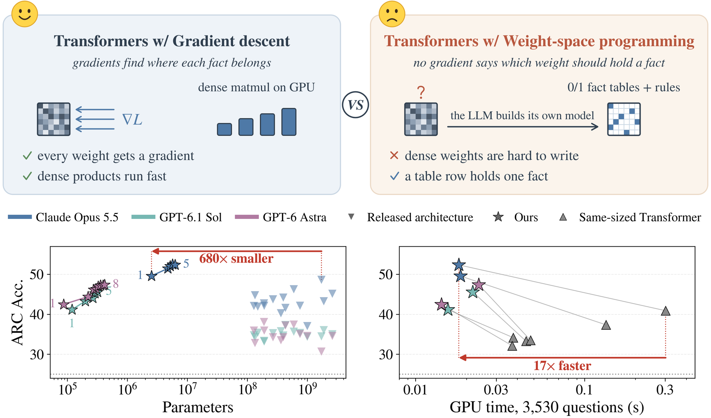
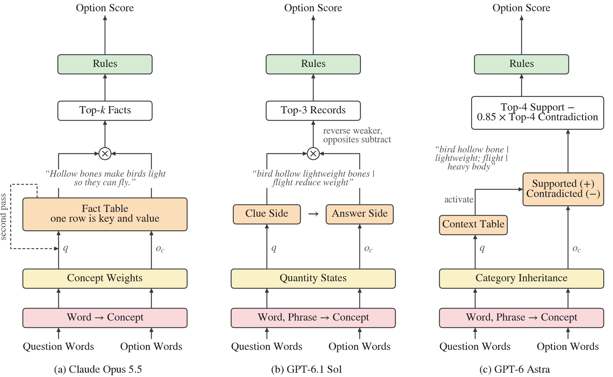
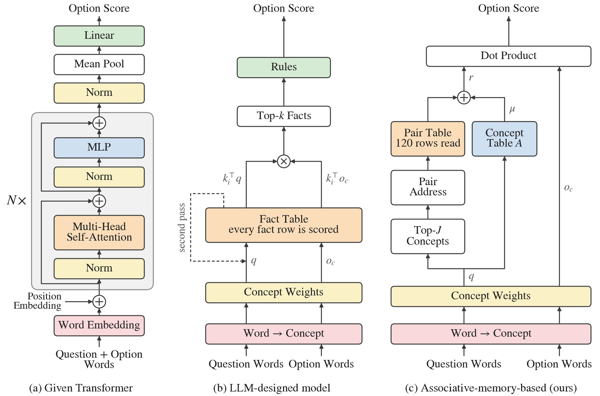

# Weight-Space Programming Doesn't Need Transformers

<div align="center">

[](https://wsp-no-transformer.github.io)  [](LICENSE)

**Hyunjong Ok, Jaeho Lee**<br>
POSTECH

</div>



*At the top, gradient descent gives every weight a gradient, while in weight-space programming the LLM decides which weight holds a fact; at the bottom left, our associative-memory-based model is about 680 times smaller than the most accurate released architecture that the same LLM wrote; at the bottom right, it answers up to 17 times faster than a same-sized Transformer.*

## TL;DR

- In weight-space programming (WSP), an LLM writes a model's weights by hand, with no gradient training. Given ten labeled ARC examples, three LLMs (Claude Opus 5.5, GPT-6.1 Sol, and GPT-6 Astra) either write a fixed architecture's weights or design the model.
- Free to design, all three LLMs build a sparse table of written facts read by a fixed procedure, reaching up to 54.4% ARC test accuracy. An LLM-designed model beats the most accurate released Transformer that the same LLM wrote while using about 1,800 times fewer parameters.
- A table lets the LLM say what each weight means, so each answer traces to one written row and removing a row changes few other answers.
- Our associative-memory-based model keeps line-by-line writing and runs up to 17 times faster on a GPU than a same-sized Transformer.

## What the LLMs Build

All three LLMs map words to concepts, compile hand-written lines into sparse tables, score each option against the best few rows, and add hand-written rules, while differing in how a row is split. Claude Opus 5.5 uses one sentence that is both key and value, GPT-6.1 Sol uses a clue side and an answer side, and GPT-6 Astra uses supported and contradicted answers.



## Our Associative-Memory-Based Model

The figure below compares the given Transformer on the left, Claude Opus 5.5's LLM-designed model in the middle, and our associative-memory-based model on the right. Our model folds written facts into a pair table read at computed addresses, so each question reads a fixed number of rows.



## Results

The table below reports ARC test accuracy (%) on 3,530 questions.

| Writer | Written released architectures | Written two-layer Transformer | LLM-designed (first / last generation) | Ours (first / last generation) |
|---|---:|---:|---:|---:|
| Claude Opus 5.5 | 43.1 | 36.1 | 50.8 / 54.4 | 49.6 / 52.4 |
| GPT-6.1 Sol | 35.0 | 36.3 | 44.6 / 47.4 | 41.2 / 45.6 |
| GPT-6 Astra | 34.4 | 32.6 | 42.7 / 46.2 | 42.5 / 47.4 |

Last generations are 5, 7, and 5 for the LLM-designed lineages and 5, 5, and 8 for ours. Chance is 25%. The full table, gradient-descent baselines, and fine-tuned baselines are in the paper.

## What Is in This Repository

- `wsp/`: Task loaders, model builders and runners, lineage rules, and released-architecture start preparation.
- `harness/`: Bubblewrap sandbox runner, network proxy, dispatcher, lineage controller, and model scorer.
- `baselines/`: Gradient-descent training and fine-tuning scripts for given, size-matched, and released architectures.
- `prompts/`: The task files that writers received, verbatim, and the two instructions given at the start of a run and after each reply.
- `tests/`: Offline CPU unit tests for tasks, static model checks, sandboxes, and scoring.
- `models/`: Released text-defined ARC models from all three writers, each with a reduced `result.json`.
- `bm25/`: Text files, retrieval solver, and stored scores for the 42 Claude Opus 5.5 runs behind the BM25 comparison in the paper: 28 released architectures written from random initialization, 6 written two-layer Transformers, 4 LLM-designed models from generations 1 and 5, and 4 associative-memory-based models from generations 1 and 5. `bm25/text/` holds the 42 text files, one per run and named by the run, each containing every non-comment line of the text files that the LLM delivered with the model, excluding the vocabulary file. `bm25/bm25.py` runs the BM25 retrieval solver on the ARC test questions, and `bm25/results.json` holds, per run, the number of lines, the model's own test accuracy, and the BM25 accuracy with and without stemming.

Measurement, analysis, and plotting code is not included, with the single exception of `bm25/bm25.py` for rerunning the BM25 comparison.

## Released Models

Models live under `models/<writer>/<run>/` by writer (`opus`, `sol`, `astra`) and run name. Each folder holds the LLM-written text files, `build.py`, `arch.py` where given or LLM-designed, `NOTES.md` written by the LLM, and a reduced `result.json` (accuracies, parameter counts, wall time, token counts).

For the `free*-arc` and `mem_assoc2*-arc` lineages, `models/` keeps the highest-validation valid replicate per completed generation. For the given two-layer transformers (`transformer-arc`, `transformer_d*-arc`), every valid replicate is kept. Edited released checkpoints (`lm-*` runs, 100M to 2.6B parameters) are not included because of their size.

| Writer | LLM-designed (`free*-arc`) | Associative memory (`mem_assoc2*-arc`) | Given transformer (`transformer*-arc`) | Total |
|---|---:|---:|---:|---:|
| `opus` | 5 | 5 | 10 | 20 |
| `sol` | 7 | 5 | 6 | 18 |
| `astra` | 5 | 8 | 5 | 18 |

Total: 56 models (68 MB, all text files).

## Setup

Writer sandboxes and model builds run on Linux inside bubblewrap `bwrap` (`0.6.3` used). The main environment uses Python `3.11` (`3.11.13` used) with the pinned packages in `requirements.txt`. A second environment (`WSP_SLM_VENV`) is needed only for released-LM fine-tuning and scoring `qwen3_5`, `rwkv7`, and `ultrabert` runs: `torch 2.7.1` with `cu128`, `transformers 5.22.2`, `numpy 2.4.6`, `pandas 3.1.1`, `pyarrow 26.0.1`, `huggingface_hub 2.4.0`, `safetensors 0.8.0`, `peft 0.21.2`, `tokenizers 0.23.3`, `accelerate 1.15.0`, and `flash-linear-attention 0.6.0`.

Writer sessions need the Claude Code CLI (`2.1.319` used) and a logged-in Claude Code profile (config directory), configured through environment variables whose values are never stored in the repository:

- `WSP_DATA_ROOT`: Task data, `runs*/` folders, and baseline outputs; raises an error on first use if unset.
- `HF_HOME`: Hugging Face dataset cache; defaults to `~/.cache/huggingface`.
- `WSP_VENV`: Python environment bind-mounted into sandboxes, whose `python` runs the score step of `lm-*` runs; defaults to the running interpreter's `sys.prefix`.
- `WSP_SLM_VENV`: Second Python environment for released-LM fine-tuning and `qwen3_5`, `rwkv7`, and `ultrabert` scoring.
- `WSP_CLAUDE_BIN`: Claude Code CLI executable mounted at `/opt/claude` in the sandbox.
- `WSP_CLAUDE_PROFILES`: Comma-separated `<key>=<config dir>` list of logged-in Claude Code config directories for writer runs.
- `WSP_THREADS`: PyTorch CPU threads for `harness.run`; defaults to `2`.

Every step runs on one Linux machine: writer runs, lineages, scoring written ARC models, and start preparation run on CPU (except `qwen3_5` and `rwkv7` starts, whose `flash-linear-attention` import needs a GPU driver), while scoring edited `lm-*` checkpoints and running `baselines.arc_released`, `baselines.train_open`, and `baselines.train_reference` require one CUDA GPU.

## Usage

Run commands from the repository root on one Linux machine. Set the base paths and download ARC once (`HF_HUB_OFFLINE=1` works afterward).

```bash
export WSP_DATA_ROOT=/path/to/wsp_data HF_HOME=/path/to/hf WSP_VENV=/path/to/venv
export WSP_CLAUDE_BIN=/path/to/claude
huggingface-cli download allenai/ai2_arc --repo-type dataset
```

### 0. Prepare released-architecture starts

Only for `lm-<name>-pre`, `lm-<name>-init`, and `baselines.arc_released --from-init`. Cache ARC and the base checkpoints named in `wsp/lm_archs/` in `HF_HOME` first; this step runs on CPU (64 GB RAM was used for 2B to 2.6B models) and writes `$WSP_DATA_ROOT/lm_start/<name>/{pre,init}/`. `qwen3_5_0_8b`, `qwen3_5_2b`, and `rwkv7_0_1b` need `WSP_SLM_VENV` on a machine with a GPU driver because `flash-linear-attention` is imported.

```bash
HF_HUB_OFFLINE=1 python -m wsp.prepare_lm_start smollm2_135m gemma2_2b ...
HF_HUB_OFFLINE=1 $WSP_SLM_VENV/bin/python -m wsp.prepare_lm_start qwen3_5_0_8b qwen3_5_2b rwkv7_0_1b
```

### 1. One writer run

Prepares the sandbox, runs the self-test, launches the writer, and scores the model to `$WSP_DATA_ROOT/runs_arc[_<writer>]/<arch>_blind_K0_r<rep>/result.json` (other paper `--arch` values: `mem_assoc2-arc`, `transformer-arc`, `transformer_d<8|12|16|24|36|216|420>-arc`; re-score with `--finalize-only`).

```bash
# Opus through a Claude Code profile
WSP_CLAUDE_PROFILES=a=/path/to/claude_config python -m harness.run --arch free-arc --data-access blind --rep 0 \
    --writer opus --profile a
```

### 1b. Released architectures

Runs with `--arch lm-<name>-pre` or `lm-<name>-init` need the Step 0 starts and one CUDA GPU on the same machine for scoring. After the writer ends, `harness.run` runs the delivered `model/edit.py` once more in `bwrap` on CPU and then runs the score step as a local subprocess (`<venv>/bin/python -m harness.lm_score <run_dir> <arch>` on GPU, using `WSP_SLM_VENV` for `qwen3_5`, `rwkv7`, and `ultrabert` and `WSP_VENV` otherwise), writing `<run_dir>/score.json` and logging to `logs/lm_score/<run>.out`. A run that already has `edit.json` and `score.json` resumes without rerunning either step.

```bash
python -m harness.run --arch lm-smollm2_135m-pre --data-access blind --rep 0 --writer opus --profile a
# Score step alone, after the edit has run
python -m harness.lm_score <run_dir> lm-smollm2_135m-pre
```

### 2. A lineage

Dispatch generation 1 first; `harness.lineage_run` seeds `g >= 2` from the best-validation valid replicate of `g - 1` until a generation fails to exceed all earlier ones or hits `wsp.lineage.MAX_GENERATION`. Pass `--mem-ceiling-mb <MB>` to start no new run while unreclaimable memory in the user's cgroup exceeds `<MB>`.

```bash
python -m harness.dispatch --archs free-arc --conditions blind-K0 --reps 2 --writer opus --profiles a
python -m harness.lineage_run --task arc --writer opus --dispatch-args "--profiles a --per-profile 2"
# associative-memory lineage
python -m harness.dispatch --archs mem_assoc2-arc --conditions blind-K0 --reps 2 --writer opus --profiles a
python -m harness.lineage_run --task arc --given mem_assoc2 --writer opus --dispatch-args "--profiles a --per-profile 2"
```

### 3. Build and score a released model

Builds and scores a `models/` folder in `bwrap` on ARC validation and test against its `result.json` (`WSP_DATA_ROOT` can be any directory).

```bash
python -m harness.score_model models/opus/free5-arc_blind_K0_r1
```

### 4. Gradient-descent and fine-tuning baselines

Baselines default to `--device cuda` and write to `$WSP_DATA_ROOT/baselines_arc`, `baselines_open`, and `baselines`. `train_pair`, `arc_size_matched`, `arc_matched_gd`, and `train_gd` accept `--device cpu`, and `distill_students` accepts `--device <torch device>`, while `baselines.arc_released`, `baselines.train_open`, and `baselines.train_reference` need a GPU. Run `baselines.arc_released` in `WSP_SLM_VENV`; `--from-init` uses the Step 0 `init` starts.

```bash
python -m baselines.train_pair --archs transformer --n-train 30 100 300 1000 3358 --seeds 0 1 2
python -m baselines.arc_size_matched --families mlp cnn transformer ssm
python -m baselines.arc_matched_gd --widths 8 24 68 72 76 256 268
python -m baselines.arc_released
# From random initialization: full ARC train, then 10/100/1000 questions with subset seeds 0-2
python -m baselines.arc_released --from-init --models <model>...
for n in 10 100 1000; do for s in 0 1 2; do
    python -m baselines.arc_released --from-init --models <model>... --n-train $n --subset-seed $s; done; done
python -m baselines.distill_students <run_dir>
python -m baselines.train_open --task sq1 --n-train 100 1000 10000 0
python -m baselines.train_gd ; python -m baselines.train_reference
```

### 5. BM25 over the written text

`bm25/bm25.py` runs the BM25 retrieval solver over one or more `bm25/text/` files on the ARC test questions and prints the accuracy next to the value stored in `bm25/results.json`. Run from the repository root with ARC in the Hugging Face cache; `--stem` selects the stemmed variant reported in the paper.

```bash
python -m bm25.bm25 --stem bm25/text/free-arc_blind_K0_r0.txt
```

Offline CPU tests: `WSP_DATA_ROOT=<dir> HF_HOME=<cache with ARC> HF_HUB_OFFLINE=1 python -m pytest tests -q`.

## Notes on Reproducibility

Evaluations are deterministic per CPU, but scores of some models can differ by a few tenths of a point across CPU types due to floating-point summation order. Rescoring on an AMD EPYC 7302 CPU node reproduces the stored `result.json` scores exactly; on an Intel Xeon Silver 4314 CPU, given-transformer scores differ by up to 0.4 points. Writer runs call commercial LLMs and are not deterministic.

## Third-Party Data and Models

ARC (AI2 Reasoning Challenge, `allenai/ai2_arc`) is downloaded from the Hugging Face Hub at run time and is licensed under CC BY-SA 4.0. Other benchmarks in the codebase and the released checkpoints keep their own licenses; none of them is redistributed here.

## License

Code and released models are licensed under the MIT License (see `LICENSE`).
